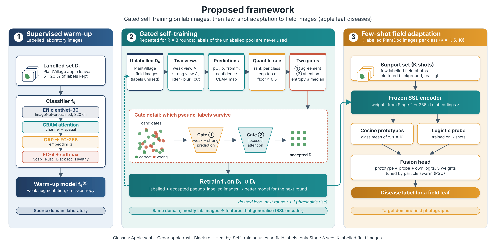

# Self-Training and Few-Shot Adaptation for Label-Efficient Apple Leaf Disease Recognition under Laboratory-to-Field Shift

Code and result files for the manuscript of the same title (Anny Leema A, Paidimarri Sai Thanuj, K. Pranoj Kumar, S. Jayanth Reddy, Balakrishnan P; Vellore Institute of Technology).



## What is here
| Path | Content |
|---|---|
| `code/improve_experiments.py` | EfficientNet-B0 + CBAM classifier; supervised baselines; self-training (fixed and per-class quantile threshold); attention/agreement gates; few-shot adaptation (prototypes, logistic probe, fusion head, PSO, BN calibration) |
| `code/baselines_ssl.py` | FixMatch and FlexMatch baselines under the same splits and backbone |
| `code/merge_stats.py` | Merges result files; prints mean ± SD, 95% CI and paired t / Wilcoxon tests |
| `code/parse_logs.py` | Rebuilds result rows from saved run logs |
| `results/` | Per-seed result files used for the tables in the paper |
| `logs/` | Run logs (add your Colab logs here) |

## Data (not included)
- PlantVillage: https://github.com/spMohanty/PlantVillage-Dataset (apple classes: scab, black rot, cedar apple rust, healthy; the `color` folder)
- PlantDoc: https://github.com/pratikkayal/PlantDoc-Dataset

Download both and note their folder paths. PlantDoc is split once with a fixed seed (1234) into 136 unlabelled images (labels never used) and 137 evaluation images; the split is generated by the code and is identical for every run.

## Install
```bash
pip install -r requirements.txt
```

## Run (Google Colab, Tesla T4)
Main experiments (E1 to E4), for example seeds 0 to 7 at 10% labels:
```bash
python code/improve_experiments.py --pv_dir /path/to/PlantVillage/raw/color --pd_dir /path/to/PlantDoc --out out --seeds 0 1 2 3 4 5 6 7 --fractions 0.10
```
FixMatch and FlexMatch (seeds 0 to 4):
```bash
python code/baselines_ssl.py --pv_dir /path/to/PlantVillage/raw/color --pd_dir /path/to/PlantDoc --out out_baselines --seeds 0 1 2 3 4 --fractions 0.10 --steps 1000
```
Statistics over merged result files:
```bash
python code/merge_stats.py results/results_seeds0-2.json results/results_seeds3-7.json
```
Run `improve_experiments.py` with a new `--out` folder for each batch of seeds, because it overwrites `results.json` in its output folder.

## Results files
- `results_seeds0-2.json`, `results_seeds3-7.json`: E1 to E4, 10% labels (eight seeds together).
- `results_fixmatch_flexmatch_seeds0-4.json`: FixMatch and FlexMatch.
Seeds, label fractions and settings match the tables in the paper.

## Citation
Please cite the paper (details to be added after publication).

## Licence
Code: MIT (see `LICENSE`). The datasets keep their own licences.
